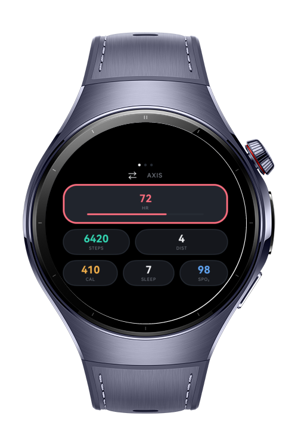
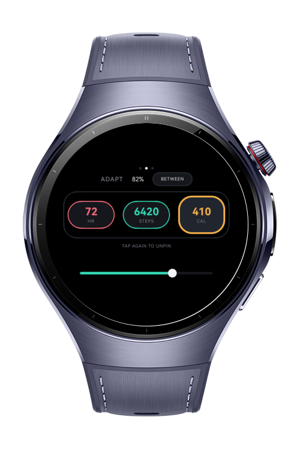
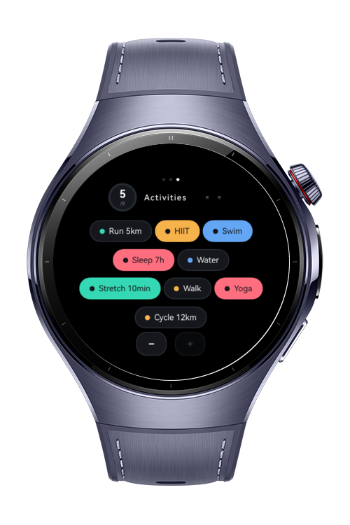

> **Note:** To access all shared projects, get information about environment setup, and view other guides, please visit [Explore-In-HMOS Index](https://github.com/Explore-In-HMOS/hmos-index).

# How to Build Flex Layout

A wearable codelab app for the ArkUI **Flex** container. A round-screen swiper routes to three full-screen pages, each
isolating one axis of Flex behaviour: **AxisPage** (distributing leftover space), **AdaptPage** (running out of space),
and **WrapPage** (multi-line flow). Shared tile faces come from global `@Builder` functions so every page renders an
identical metric card.

# Preview

<div>
  
  
  
</div>

# Use Cases

- Swipe through three Flex demos, each one full-screen and self-contained.
- **AxisPage** — split leftover main-axis space by `flexGrow` ratio (2:1 and 1:1:1), and flip reading order with
  `FlexDirection.RowReverse`. Tap a support tile to promote it to hero.
- **AdaptPage** — squeeze a metric strip with a slider and watch it degrade: tiles yield width by `flexShrink` weight,
  stop at a `constraintSize` floor, then drop by `displayPriority`. Tap a tile to pin it.
- **WrapPage** — reflow activity chips across lines with `FlexWrap.Wrap`, adjust the chip count, and toggle gap density
  via `space.main` / `space.cross`.
- Round-screen navigation — hand-drawn page crumbs replace the native Swiper indicator, which the circular bezel clips.

# Technology

### Stack

- **Languages**: ArkTS, ArkUI
- **Frameworks**: HarmonyOS SDK 5.1.0(18)+, API 23 and below
- **Tools**: DevEco Studio Version 5.1.0.828+
- **Libraries**:
    - `@kit.ArkUI` (UI Components & Layouts — `LengthMetrics`)

### Flex Properties Covered

**Container properties** (passed to the `Flex({ ... })` constructor):

- `direction` — which way tiles line up. Left-to-right everywhere; `RowReverse` flips AxisPage around.
- `justifyContent` — where tiles sit along the row when there is space left over.
- `alignItems` — how tiles line up top-to-bottom. Centred for tile rows, full-height for the AdaptPage strip.
- `wrap` — lets WrapPage chips drop to a new line instead of being squeezed.
- `alignContent` — spreads those wrapped lines evenly down the screen.
- `space` — the gap between tiles. `main` along the row, `cross` between lines on WrapPage.

**Child properties** (chained onto children of a `Flex`):

- `flexGrow` — how big a share of the row each tile takes. 2 makes a tile twice as wide as 1.
- `flexBasis` — the width a tile asks for before growing or shrinking. `0` on AxisPage.
- `flexShrink` — how readily a tile gives up width when the row gets tight. `0` means it never does.
- `displayPriority` — which tile disappears first once nothing more can be given up.
- `alignSelf` — lets one pinned tile ignore the row's vertical alignment and stretch full-height.
- `constraintSize` — the smallest width a tile will accept. It stops shrinking here.
  |

### Key Technical Implementations

- **Set `flexBasis(0)` before using `flexGrow`.** Otherwise the ratio only splits the space left over after each tile's
  natural width, so a 2:1 ratio does not actually look 2:1.
- **Shrinking has to stop before dropping can start.** With `flexShrink` alone tiles just keep getting narrower and the
  row never runs out of room, so `displayPriority` never comes into play. A `constraintSize` minimum width is what
  puts the brakes on. Worth checking on a real watch, not just the Previewer.
- **Global `@Builder` functions** live in `MetricCommon.ets` outside any struct and are called without `this.`, so all
  three pages share the same tile face.

# Directory Structure

```
FlexCodelab
|--- entry/src/main/ets/
| |--- pages/
| | |--- Index.ets              # Swiper host and page routing
| |
| |--- view/
| | |--- AxisPage.ets           # flexGrow / flexBasis / FlexDirection demo
| | |--- AdaptPage.ets          # flexShrink / displayPriority / alignSelf demo
| | |--- WrapPage.ets           # FlexWrap / alignContent / space demo
| | |--- MetricCommon.ets       # Global Builders and per-key config functions
| |
| |--- model/
| | |--- HealthData.ets         # Metric type and sample data
| | |--- Theme.ets              # Color and radius tokens
|--- screenshots/           # UI Preview images for documentation
```

# Constraints and Restrictions

## Supported Device

* Huawei Watch 5
* HarmonyOS wearable emulator (UI, navigation, web page, lifecycle logs)

## Limitations

* Targets API 23 and below.
* `flexShrink` defaults to `1` under a `Flex` parent but `0` under `Row` / `Column`. This is the most common cause of a
  layout changing when the container is swapped.
* `Flex` resolves grow/shrink with an extra measure pass, so it is slower than `Row` / `Column`. Prefer the simpler
  containers where the resolution is not needed.

# License

**FlexCodelab** is distributed under the terms of the MIT License.
See the [LICENSE](./LICENSE) for more information.